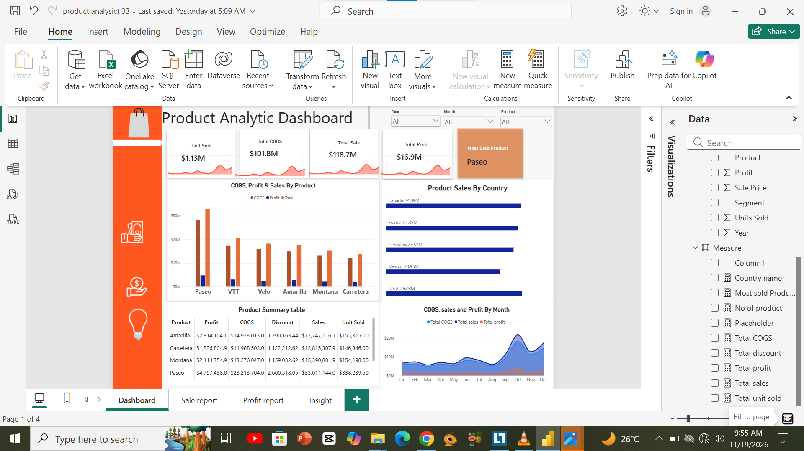

# 📊 Product Sales, Profitability & Business Performance Analysis

### Turning Business Data into Actionable Insights with Power BI

## 📌 Project Overview

This project focuses on analyzing product sales, profitability, cost performance, and geographical revenue distribution using **Microsoft Power BI**.

The goal was to transform business data into meaningful insights through interactive dashboards, performance indicators, and visual analytics that support informed business decision-making.

The analysis examines six products across five geographical markets, evaluating their contributions to overall revenue and profitability while identifying monthly performance trends and potential areas for improvement.

The resulting dashboard provides a consolidated view of business performance, enabling stakeholders to monitor key metrics, compare product performance, and identify opportunities for growth and cost optimization.

## 🎯 Project Objectives

The primary objectives of this project were to:

- Analyze overall business performance using sales, profit, COGS, and units sold.
- Identify the highest- and lowest-performing products based on profitability.
- Evaluate geographical sales performance across different countries.
- Examine monthly sales, COGS, and profit trends.
- Assess the relationship between revenue, costs, and profitability.
- Identify business performance gaps and opportunities for improvement.
- Develop actionable recommendations to support strategic business decisions.

## 🛠️ Tools & Technologies

| Tool | Application |
|---|---|
| Microsoft Power BI | Dashboard development and data visualization |
| Power Query | Data preparation and transformation |
| DAX | KPI calculations and business metrics |
| Data Visualization | Performance monitoring and trend analysis |
| Business Intelligence | Insight generation and decision support |

## 📂 Dashboard Structure

The Power BI report consists of four pages:

**1. Main Dashboard**
- Overall business performance KPIs.
- Total sales, COGS, profit, and units sold.
- Most-sold product.
- Product sales and profitability comparison.
- Geographical sales distribution.
- Monthly sales, COGS, and profit trends.
- Interactive Year, Month, and Product filters.

**2. Sales Report**
- Dedicated sales performance reporting.
- Product and business performance exploration.

**3. Profit Analysis**
- Profit contribution by product.
- Geographical profit comparison.
- Monthly profitability trends.
- Product-level financial summary.

**4. Insights**
- Business performance observations.
- Key findings and opportunities.
- Actionable business recommendations.

## 🔄 Project Workflow

The project followed a structured data analytics workflow:

**Step 1: Data Understanding**
- Reviewed the available business dataset and its key fields.
- Identified relevant variables, including Product, Profit, Sale Price, Segment, Units Sold, and Year.
- Established the key business questions to guide the analysis.

**Step 2: Data Preparation**
- Prepared the available data for business performance reporting.
- Organized relevant fields for product, geographical, and monthly analysis.
- Prepared the reporting structure for visualization and KPI monitoring.

**Step 3: Data Analysis & KPI Development**
- Evaluated total sales, COGS, profit, and units sold.
- Examined product-level profitability.
- Compared geographical sales performance.
- Investigated monthly financial trends.
- Calculated additional performance indicators, including profit margin.

**Step 4: Dashboard Development**
- Developed interactive Power BI report pages.
- Created KPI cards, bar charts, trend visualizations, and summary tables.
- Incorporated Year, Month, and Product slicers for interactive exploration.

**Step 5: Insight Generation & Recommendations**
- Identified leading and lower-performing products.
- Evaluated geographical revenue differences.
- Highlighted monthly profitability fluctuations.
- Translated findings into practical business recommendations.

## 📈 Key Performance Indicators

The analysis revealed the following business performance figures:

| KPI | Result |
|---|---:|
| Total Sales | $118.7M |
| Total COGS | $101.8M |
| Total Profit | $16.9M |
| Units Sold | 1.13M |
| Profit Margin | 14.24% |
| Most-Sold Product | Paseo |

*Note: Financial values are approximate, based on the dashboard's displayed figures.*

## 🔍 Key Business Insights

**1. Overall Business Profitability**

The business generated approximately $118.7M in sales and $16.9M in profit, representing an estimated profit margin of 14.24%. COGS accounts for approximately 85.76% of sales, highlighting the importance of monitoring product costs and improving cost efficiency.

**2. Paseo Leads Product Profitability**

Paseo recorded approximately $4.8M in profit, making it the highest profit contributor among the six products. It was also identified as the most-sold product, demonstrating its importance to overall business performance.

**3. Carretera Records the Lowest Product Profit**

Carretera generated approximately $1.83M in profit, the lowest among the six products analyzed. This creates an opportunity to investigate its pricing, discount structure, sales volume, and production costs.

**4. USA Leads Geographical Sales Performance**

The United States recorded the highest sales at approximately $25.03M, followed by Canada ($24.89M), France ($24.35M), Germany ($23.51M), and Mexico ($20.95M).

**5. Monthly Profitability Shows Significant Fluctuations**

October recorded the highest monthly profit, followed by a noticeable decline in November and a recovery in December. These changes highlight the need for continuous monitoring of monthly revenue, costs, and product performance.

## 💡 Business Recommendations

Based on the findings, the following recommendations were identified:

**1. Optimize Cost Management**

Review procurement expenses, supplier pricing, and product costs to identify opportunities to reduce COGS and improve overall profitability.

**2. Strengthen High-Performing Products**

Maintain adequate inventory for Paseo, monitor customer demand, and identify the factors contributing to its strong sales and profitability.

**3. Review Lower-Performing Products**

Investigate Carretera's pricing, discount levels, sales volume, and cost structure to identify opportunities to improve its profit contribution.

**4. Strengthen Geographical Market Strategies**

Maintain strong performance in the USA while investigating opportunities to increase sales in Mexico through market research, targeted marketing, and distribution improvements.

**5. Monitor Monthly Financial Performance**

Investigate the factors associated with October's profit peak and November's decline. Introduce regular performance reviews to identify changes in revenue, costs, and profitability.

## 📊 Business Value

This project demonstrates how business intelligence can support organizations in:

- Monitoring financial and operational performance.
- Identifying profitable products and potential performance gaps.
- Understanding geographical revenue distribution.
- Evaluating monthly business performance.
- Identifying opportunities for cost optimization.
- Supporting evidence-based strategic decisions.

## 🚀 Potential Future Enhancements

Further development could include:

- Year-over-year sales and profit comparisons.
- Product-level and country-level profit margin analysis.
- Sales and profitability forecasting.
- Discount impact and pricing analysis.
- Customer and segment-level performance analysis.
- Automated executive insights and performance alerts.

## 🧠 Skills Demonstrated

- Business Intelligence & Data Analytics
- Microsoft Power BI
- Data Visualization
- DAX & KPI Development
- Power Query
- Product Performance Analysis
- Profitability Analysis
- Financial Performance Reporting
- Business Insight Generation
- Strategic Recommendations

  

## 👨‍💻 Author

**Aminu Abdulrasheed**

Data Analyst | Business Intelligence | AI & Digital Innovation

I enjoy transforming raw data into meaningful insights that help organizations understand performance, identify opportunities, and make better business decisions.

- **Portfolio:** https://github.com/Abdulrasheed055/Data-analyst-portfolio
- **LinkedIn:** https://linkedin.com/in/aminu-abdulrasheed-747597232/
- **YouTube:** https://youtube.com/@AminuAnalyst

---

*If you find this project interesting, feel free to explore my other data analytics and business intelligence projects.*
